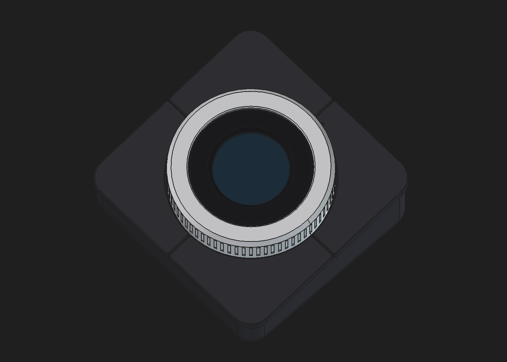

# Hidden-snap central press prototype

The encoder measures rotation only. A fifth switch at the centre detects ring presses. Four
folded printed flexures support an X bridge; the display remains fixed above it.

[Mechanism cutaway](reference/hidden-snaps-cutaway.png) ·
[Cap underside and concealed joints](reference/hidden-snaps-cap-underside.png)

## What changed

- Carrier pillars now have split retaining heads and seating shoulders for the fixed flexure pads.
- The bridge has downward split pillars retaining the moving pads. The four leaves remain
  separate, replaceable parts, with straight Ø2.4 holes and no countersinks.
- Four Cap columns seat on the bridge and end in concealed split pegs. Blind bridge sockets
  catch their barbs. The solid column shoulders carry the pressing load. No hole reaches the Cap face.
- Four integral Cap tongues catch a continuous ledge inside the ring. The separate RingKeeper,
  its screws, and both press-fastener dummy objects are removed. The ring ledge passes outside
  the Cap bearing during assembly. Its flat top rests 0.18 below the hooks' flat retaining faces.

These are positive snap joints, not loose locating pins. A loose pad can rock and change the
spring response. Nominal pad/Cap joints have touching seating and retaining faces; actual
printer error may prevent engagement or leave play. Print a joint fit sample before a full case.

The hidden ring retainer now has three upward printed snap tongues catching pockets in the
ring. There are no retainer screws or protrusions below its original underside. Small aligned
release openings preserve the tongue roots and admit a thin probe locally. The only remaining
case screws are the four M2 × 12 under the feet.

[Exploded ring/retainer joint](reference/retainer-snap-exploded.png). Print the retainer in PETG
as a trial, flat annulus down and tongues up. Inspect the localized thin neck walls and all
three barb engagements. Nominal clamping faces touch; fit and height variation need testing.

## Printing and assembly

Use exported orientations. Cap and bridge print face down; the bridge's X face stays flat.
Flexures print flat, top down, with 0.8 leaves and 2 mm end pads. PETG is a trial material for
snaps and leaves, not a validated fatigue choice. Inspect split slots, thin socket walls, hook
roots and the ring's 0.9 mm inward shelf in the slicer. Remove any support without damaging a tongue.

1. Inspect the wire channels and module pins; fit the fifth switch matching v4's 7.2 modeled
   tip height. GPIO5 goes to this switch; HW-040 SW stays unwired. Meter actual switch pairs.
2. Off the carrier, press each moving flexure pad onto a bridge peg from below. Support its
   thick pad, not the thin leaf. Check that the head opens fully and the pad seats flat.
3. Lower the bridge/suspension onto the carrier. Press the fixed pads over the carrier heads.
   Confirm all four are captured without pad rocking or preloading the central switch.
4. Test the bridge alone for a click and full return. Then install the display/socket stack.
5. Lower Cap over the display. Align all four columns and press evenly until the concealed
   pegs engage the blind sockets. Each column shoulder must seat on the bridge.
6. Separately seat the ring in the shell, align all three retainer tabs and push the retainer
   upward until every barb catches and its annulus seats flat. Support the thick annulus while
   assembling. Lower shell/ring over Cap; its ledge deflects the four hidden tongues inward and snaps below them.
   Mesh the pinion gently. Confirm capture and free rotation without forcing the ledge.
7. Fit tiles, floor and feet only after the mechanism passes the checks below.

Bridge side windows expose the Cap-peg barbs for release when accessible. The full case's tool
path to those windows and the ring hooks has not been established. This is not yet a proven
serviceable snap assembly: keep the trial accessible and do not assume the floor opening alone
allows disassembly. The retainer's three catches also need a practical release sequence;
releasing one tab does not guarantee it will stay disengaged while reaching the others. Test
this joint before enclosing it. Never pull against the flexure leaves to release a joint.

## Acceptance

At eight equally spaced ring positions, confirm one tactile click, electrical closure, full
return and similar force/travel. Watch for carrier bending, opposite-edge lift, loose pads,
clips backing out and rubbing. Rotate through a complete turn at rest and during a normal
click. The hooks must retain the ring at every rotation angle without drag.

Reject a fit that needs excessive assembly force, leaves a shoulder unseated, preloads the
switch, rocks at a pad, cracks/whitens a snap or fails to return. Do not increase stop travel to
force an edge click. The switch height remains v4's 7.2; 0.35 click and 0.45 stop remain trial
settings. Real switch travel, force, printed spring stiffness, creep and durability need testing.

The assembly checks use squeezed-peg and displaced-hook clearance surrogates. They establish
space for insertion, not the loaded elastic shape or required force. Four folded leaves do
not enforce perfectly parallel motion; even edge clicks remain a physical acceptance test.
