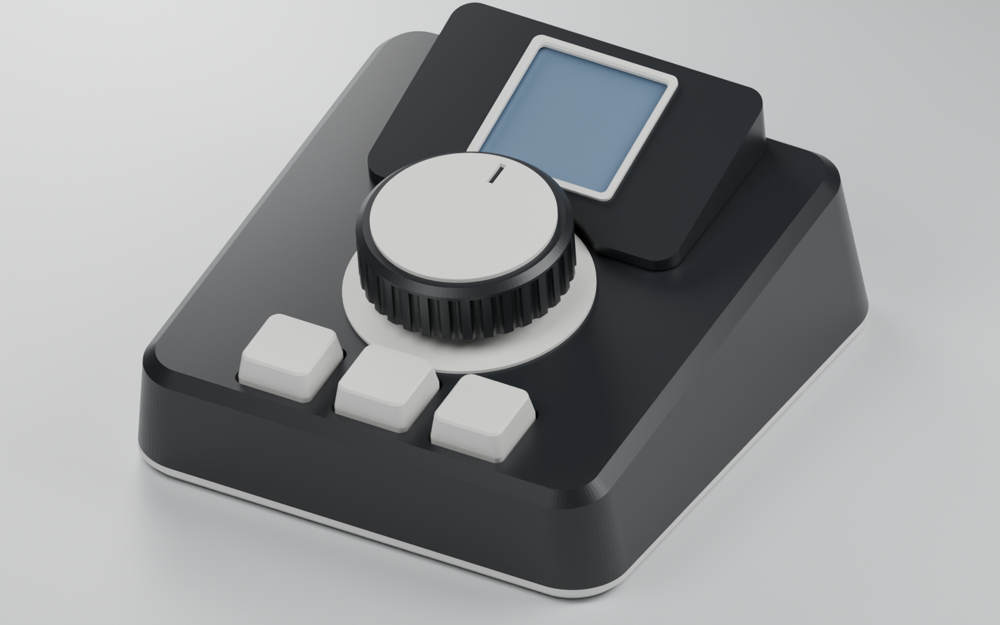

# Kivori enclosure v8 — Terrace, display raised and tilted

V8 is v7 with the display **raised and tilted 12° towards the user** (concept "B, raised, tilted"): the screen faces the seated user, a slim white lip replaces the 2 mm bezel, and the glass sits 1.2 mm under the cowl top (0.6 mm of air, 0.6 mm of roof). The display is still carried by its **own four pillars** (no wedge bracket): the pillars are of different heights, their tops are cut square to the tilted board and the pegs lean with it. The carrier is 2.0 mm thick and prints flat; the later revisions slim its far-east display pillar and widen the lip’s bed-contact face. The back plate, RP2040-Zero position and pin map stay fixed.



## What changed from v7

| | v7 | v8 |
|---|---|---|
| Display | flat, glass 2.1 mm above the face | **tilted 12°** (19.2° to the desk with the 7.2° case wedge), glass 5.8 mm above the face at the window centre (10.4 mm to the cowl top at the far end) |
| Pillars | 4, equal | 4: near pair **10.7 mm**, far pair **15.4 mm** (4.7 taller), vertical, seat cut at 12°, peg leans 12°, a slot in each far pillar clears the leaning header pins |
| Cowl | 4.5 mm, 2.5 mm roof, face-back relief | hood with the top plane parallel to the glass, 10 mm tall at the far end, **0.6 mm roof 0.6 mm above the glass**, four hold-down pads, window 25.2 mm; prints with the tilted top on the bed |
| Bezel | `DisplayBezel` 28 x 28, 2.0 x 0.8, 4 pegs | `DisplayLip`: **1.4 wide x 0.6 high**, 45° bevel over 0.4 mm, a collar locates it in the cowl window (glue it) |
| Header pins | tips 0.8 above the carrier, tail down each pin | pins **stand free** (0.8 over the cradle top and the pillar slots); wire tails drop from the pin roots to a **wire cradle** (bores and funnels) |
| Pegs | 2.0 past the board (heat-stake) | 1.0 past the board, locate only; the cowl's pads hold the board down |
| Window / DISP_C | y 78.0 | y 77.4 (the tilted header's pocket row keeps its v7 y) |

## Before you print

Every assumption that changes the physical build. The v7 assumptions that are not about the display are unchanged (see `hardware/enclosure-v7/README.md` for the wording): 0.3 mm wire wrapped on every pin in its own groove (net to net plastic 0.70 mm, tightest spot exactly 0.70), RP2040 pins in the carrier at `RP_PIN_FIT_D` 0.90 (print `PinFitCoupon` first), USB hole 1.5 mm low, pin map, encoder and key power from the display's GND and VCC, cowl pegs Ø3.0 x 3.0 (glue or friction fit; **v8: friction fit only, so the cowl comes off for service**), knob raised 2.5 mm from the first print (air gap 4.3 mm, flush hub; see Knob below), plain halo ring, flat plinth with rubber bumpers.

New or changed in v8 (the v7 display items 4, 7 and the display standoffs are replaced by these):

1. **Tilt**: `DISP_TILT` 12° about the x axis (front edge, towards the knob, low), pivot at the window centre, `DISP_Z` 5.8 mm. Pillar heights follow from it (10.7 / 15.4 mm). The far-west pillar remains Ø4.5; the far-east pillar (x 58.26, y 89.16) is **Ø3.2** beside the header, with an unchanged peg and tilted seat. It retains a Ø4.5 × 2.0 mm foot, a 0.65 mm high 45° taper and R0.25 fillets at both joins. Its weakest notched section has I = **2.591 mm⁴**, **12.9%** of plain Ø4.5 bending stiffness; seat contact is **8.22 mm²**. Print the Carrier with 3 perimeters and gently press the display in the first print to check pillar flex; the pegs lean 12° relative to the carrier normal, and 12° from build Z when printed flat.
2. **Glass is never loaded.** The module hangs on the four seats by its PCB, located by 1.8 mm pegs in the 2.0 mm holes. The cowl's four **pads** (Ø3.6, bore Ø3.0 round each peg tip) stand `DISP_PAD_GAP` **0.2 mm** over the PCB corner holes and only stop the board lifting off the pegs; they never press. Nothing printed is closer than **0.51 mm** to the glass (0.60 under the roof, 0.70 under the lip's collar, 0.51 beside the header-end pads). The lip stands on the cowl and overlaps the glass edge by **1.05 mm** (near/far edge), 0.85 (header end), 2.95 (flex end): air, never contact.
3. **Flex cable (FPC)** leaves the glass at the end away from the header and lies on the board (assumed: **18 mm wide, never higher than the glass front, 1.4 mm over the board**: measure yours). The cowl's ceiling is one plane 0.6 mm over the glass, so the flex has **2.0 mm** over the board (v7 pinched it at 1.3 and was relieved to 2.5 by a face-back pocket; a pocket would not fit a 0.6 mm roof): the keep-out box is **0.59 mm** from the cowl. Pads and pegs are clear of the 18 mm band. If your flex is wider, higher or stiffer, raise `DISP_GLASS_AIR` (the lip then hides more, see 6). Nothing of the carrier, cowl or lip touches the cable, and the cowl is lowered straight down onto the finished display, so nothing drags it.
4. **Header pins are never bent.** The smaller far-east pillar clears pins by **0.800 mm**, free wire tails by **0.984 mm**, and the cradle by **0.840 mm** (the cradle far end is shaved 0.7 mm). Including the wrap rings, the nearest modeled wire surface is **0.470 mm** away; keep the bench wraps compact. The pins (6 mm below the plastic, `DISP_PIN_L`) tilt with the board and stand free: tips **0.80 mm** over the cradle's top plane (it is parallel to the board, `DISP_PIN_TIP_CLR`) and 0.80 from the slot cut in each far pillar for them. Nothing is plugged into anything. The wires are wrapped at the pin roots (3 turns, ring Ø1.3, bench step as in v7) and leave **0.7 mm west of the pin**, so they clear it: each tail then drops **6.2 mm in a straight line** to a funnel (Ø1.7 at the top, 45°) in the cradle top, leaning 5° one way while the pins lean 12° the other (**0.23 mm minimum from any pin**, growing). The free span is the strain relief: the funnel and the Ø1.2 bore hold the wire still, so a pull on the cable never reaches the pin wrap.
5. **Wire loom, not a ribbon**: the display's ten wires (GND x3, VCC x2, five signals) are the same 0.3 mm wire as everywhere else. A ribbon or FPC extension was rejected because GND and VCC each fan out to the encoder and the keys, a ribbon would add a part, two connectors and a bend radius of its own, and the carrier already has a groove and pocket for every wire. The bend radii are: free span straight; wrap ring R 0.65 mm; the foot (vertical bore to the groove) R 0.6 mm, set by the Ø1.2 bore (all in soft 0.3 mm copper, bent once; do not reposition a wrapped wire more than a few times); grooves `WIRE_BEND_R` 1.5 mm.
6. **Rim**: the lip's window is 24.2 mm (active area 23.4 + 0.4 per side). For a seated eye 40° over the desk (59.2° over the glass, `EYE_ELEV`) the near rim hides **0.42 mm** of the active area (limit 0.5), checked by ray test in the build. The ray is steeper than the 45° bevel, and the 0.2 mm vertical section above the cowl sets the limit with the reduced bevel. The build measures the assembled rim by ray test.
7. **Cowl and lip**: the lip is now **1.4 mm wide**, 0.6 mm high, with a **0.4 mm × 45° bevel** and 0.2 mm vertical edge. Its top face on the bed is **103.85 mm²** (was about 42); check the first layer for adhesion and a continuous ring. The collar and cowl seat are unchanged, so only DisplayLip needs reprinting for this change. The lip prints top down, glue it with the collar in the cowl window (collar play 0.1 per side) on the cowl top. The cowl's roof is 0.6 mm (3 layers) over the glass: print one and check it; thicken `DISP_ROOF_T` (and `DISP_GLASS_AIR`, same pivot) if it is too weak. The cowl is 10.4 mm high at the far end and low at the knob side: the knob stays **4.16 mm** from it at rest and 4.06 pressed (0.5 mm travel; the owner restored the 4.3 mm skirt gap), the halo ring 1.00 mm.
8. **Assembly order** (see below) and service: cowl off, lift the board.
9. **Knob**: owner-approved **4.3 mm** skirt gap (`KNOB_GAP`), **11.0 mm** height (`KNOB_H`), top at z 15.3. The hub and skirt rim are **flush at z 4.3**; the build measures the underside and rejects a protruding hub. The fixed shaft tip is z 7.3, giving **3.0 mm engagement**, all on the D flat. Shaft-tip air remains **1.0 mm**, top thickness **4.5 mm**, and KnobCap peg fit is unchanged. The hub clears the bushing by **8.00 mm at rest / 7.50 pressed**, and the nut by **11.50 mm pressed**. At 0.5 mm travel the knob clears the face by **3.80 mm**, cowl **4.06 mm** (4.16 at rest), and halo **3.20 mm**. Printed top down, its ribs and hub grow from the top, with only the existing **2.00 mm** cap-peg-hole bridges. The previous 5.8 mm gap and protruding hub are superseded; increasing height cannot increase engagement on a fixed shaft.

Reprint from v7: **Carrier** (pillars, cradle and pegs; display wires move 0.7 mm west), **DisplayCowl** (new), **DisplayLip** (new, replaces `DisplayBezel`), **Knob** (flush hub, restored 4.3 mm gap), **Shell** (only the opening in the face, now 40.6 x 28.5 mm: it moves with the display). Reuse from v7: BackPlate, KnobCap, caps, HaloDiffuser, PinFitCoupon.

## Previews

- `preview-exterior.png` — assembled exterior.
- `preview-closeup-display.png` — the slim lip and the tilted screen, seen from the front.
- `preview-section-display-centre.png` — side section through the display centre (x 43): tilt, pillars, glass under the roof and the lip, the cradle and wires behind it.
- `preview-section-header-wires.png` — section through the header (x 58.9): the leaning pins, the straight wire tails, the cradle with its funnels and the slot in the far pillar.
- `preview-section-flex-end.png` — section at x 25: the left pillars, the pads over the pegs and the flex cable keep-out (yellow) under the 2.0 mm of air.
- `preview-cradle-wires.png` — the display on its four pillars over the carrier, with the cradle, pins and wires (no shell or cowl).
- `preview-front-wiring.png` — carrier front: the display wires and the display's power grooves round the east and south of it (the cradle is the rib at the right).

## Carrier thickness and wiring

The carrier is **2.0 mm** thick, from its unchanged front plane z −10.2 to its back z −12.2, with **no back-side component pockets or groove ramps**. Print it **flat, back side on the bed**, with all pillars and the wire cradle growing upwards. The display seats and glass remain at the same height: pillar dimensions are measured from the unchanged carrier front.

The six west wiring columns, encoder power vias and key-ground via are restored to their original positions from `9b9e2d7`; the PCB-outline DXF is byte-for-byte identical to that revision. Front and back grooves are 0.5 mm deep, with straight back-side wire runs. Pin wrap lengths remain **4.0 mm at the RP2040 front, 1.5 mm behind the keys and 4.0 mm behind the encoder**; the seven small display wire entry bores remain 1.0 mm deep. USB connector, RP2040 board height, encoder position, back plate, screw columns, hooks and reset guide remain fixed.

Relative to `9b9e2d7`, Carrier geometry changes only at the far-east display support: the Ø3.2 pillar with its filleted Ø4.5 foot, plus the associated **0.7 mm trim at the adjacent cradle end** that preserves 0.840 mm clearance. The display seats, pegs, carrier plate and all wiring positions are unchanged.

- `preview-knob-flush.png` — before/after sections showing the flush hub and unchanged shaft engagement.
- `preview-rear-wiring.png` — original back-side wiring on the flat 2.0 mm carrier.

## Pin-only RP2040 mount

The board is held solely by its soldered male header pins in the carrier holes (`RP_PIN_FIT_D = 0.90` mm, a CAD value, **not a verified PETG press fit**). Print `PinFitCoupon.stl` in the same orientation and settings first. Its five rows of nine holes have one to five engraved dots: 1 = 0.80, 2 = 0.85, 3 = 0.90, 4 = 0.95, 5 = 1.00 mm. Test the actual header strip without forcing it; change `RP_PIN_FIT_D` and rebuild if needed. A coupon cannot establish the assembled board's resistance to repeated USB insertion and removal; test gently. Do not power an unstable assembly.

Solder the full male header strips to the board: **all 23 pins**, i.e. the nine-pin left column (GPIO0 to GPIO8), the nine-pin right column (5V, GND, 3V3, GPIO29, GPIO28, GPIO27, GPIO26, GPIO15, GPIO14) and the five-pin bottom row (GPIO13, GPIO12, GPIO11, GPIO10, GPIO9). The carrier has a hole for every one of them; the unwired pins are present in the plastic only. The build script fails unless all 23 holes go through the carrier. The controller is rotated physically: its component-side left and right exchange sides when viewed from the carrier front. Use the printed board labels to identify the pins.

## Wiring

| RP2040-Zero | Function |
|---|---|
| GPIO3 / GPIO4 / GPIO5 | Encoder SW / DT / CLK |
| GPIO6 / GPIO7 / GPIO8 | Left / middle / right key |
| GPIO26 | LCD SCL (hardware SPI1 SCK) |
| GPIO15 | LCD SDA (hardware SPI1 TX) |
| GPIO14 / GPIO13 / GPIO12 | LCD RES / DC / BLK |
| 3V3 | Display VCC |
| GND | Display GND |

GPIO0-2, 9-11 and 27-29 are free. Encoder 3V3 and GND and the key ground are taken from the display's VCC and GND pins (see "Before you print"). No RP2040 firmware is in this branch; the pin map above is the original one, which the firmware on `feat/rp2040-zero-board-179` (`firmware/pip/src/physical_st7789.rs`) uses (not checked from here). SPI1 uses SCK on GPIO26 and TX on GPIO15 ([Raspberry Pi's RP2040 datasheet, Table 3](https://datasheets.raspberrypi.com/rp2040/rp2040-datasheet.pdf)), RES, DC and BLK are plain outputs, and the encoder and key inputs need pull-ups.

Wrap steps (3 turns, tight, tail trimmed; bare wire, so check isolation between neighbours after each group):

1. **Bench, before mounting the display.** On each display pin wrap the wires at the pin root, lowest wrap first (the ring sits just under the header plastic): GND three wires (to the RP2040 GND pin, encoder GND via the east groove, key ground via the far-east groove), 3V3/VCC two wires (to the RP2040 3V3 pin, encoder 3V3), the other five pins one wire each. Leave every tail **at least 60 mm** long (6 mm to the cradle, 11 mm down its bore and on into the groove, the rest to reach the RP2040 end and for the rewrap in service).
2. **Thread, then seat the display.** Hold the module just above its pegs and feed each tail through its funnel in the wire cradle (the rib under the header), down the bore into the pocket and into its groove; the funnels are 0.8 mm bigger than the wire and the module is in your hand, so do them one at a time from the near pin (BLK) to the far pin (GND). Pull the slack out until the wire runs straight from the ring to the funnel, then lower the module onto the four pegs (board flat on the four pillar seats). The seven display grooves run to the RP2040's right column and bottom row, and none crosses another.
3. **RP2040 side.** Wrap each display wire on its pin, 4 mm of pin stand above the carrier: GND and 3V3 on the right column, GPIO26, GPIO15, GPIO14 below them, GPIO13 and GPIO12 on the bottom row. Every pin has a free ring of 1.3 mm round it.
4. **Left column to the back.** GPIO3-8 each have a groove west to their own 0.8 mm hole. Wrap the wire on its pin, lay it in its groove, drop it through its hole and, on the back, straight down its column of the west corridor. The key wires (GPIO6-8) are the westmost columns; they turn east above the keys and go straight down to the upper right leg of the left, middle and right key. The encoder wires (GPIO3-5) turn east into the SW, DT and CLK pins.
5. **Encoder power and key ground.** The 3V3 and GND wires from the display pins run on the front east and south of the display, then west and down to a hole east of the encoder pins and a short hop west on the back to the encoder + and GND pins. The key ground wire runs far east (x 75) down to a hole beside the right key and west on the back to its free lower right leg. Link the keys' ground chain with two short wires on the back (left lower-right to middle lower-left, middle lower-right to right lower-left).
6. **Check the display before the cowl goes on**: nothing touches the glass, the flex cable lies flat on the board and nothing presses on it (a 0.8 mm feeler, or the 0.8 mm tip of a pin, must go under where the roof will be), the pins are straight and clear of every wire except their own ring.
7. Check 3V3 to GND for a short before plugging in USB.

Wrap room (model values): RP2040 pins 4.0 mm above the carrier (3 turns need 0.9 mm), encoder pins 4.0 mm bare behind the carrier, key legs 1.5 mm behind it (the legs are flat 0.7 x 0.3, wrap tight). Each key's two lower legs (12.5 mm apart) are internally connected; the ground chain relies on this: check with a multimeter that the switch is not rotated 90°.

A **1.4 mm reset access hole in the bottom cover** is aligned to the flipped board's RESET button; its internal guide ends 0.6 mm before the modeled button. Use a slender blunt nonconductive probe and press gently. BOOT remains accessible with the case open. Verify alignment and travel with the real board before fitting the cover.

## Assembly order

1. Solder headers to the RP2040-Zero, press the board into the carrier.
2. Wrap the display wires on the display pins on the bench (wiring step 1), thread them through the cradle and seat the display on its four pegs (step 2). The module goes in from the front through the face opening, with the cowl off.
3. Wrap the RP2040 pins and lay the grooves, then the left-column wires through their holes. On the back wrap the encoder pins and key legs (fit the encoder module after the key legs, as its board covers the area).
4. Check the display (step 6), glue the white lip into the cowl window, lower the cowl over the module (its four pads land on the board corners over the pegs, its four pegs go into the shell face) and press it flat. Nothing of the cowl or lip touches the glass or the flex cable.

**Service**: pull the cowl (friction pegs) and lift the board straight off its pegs; 6 mm of free wire between each pin root and the cradle lets you tilt it for a look, no more. To go further, unwrap the ten wires at the pin roots (they are re-wrapped like new; keep the 60 mm tails) and the board is free.

## PETG printing

The export folder contains individually oriented STLs. Keep their exported orientation. Start with a 0.4 mm nozzle, 0.20 mm layers and your normal PETG profile on textured PEI. Slice and inspect grooves, bores, funnels and first-layer contact. **Carrier prints flat on its back**, without the former −45° rotation or edge brim. Its pillars are vertical and display pegs lean 12° from build Z. Print with 3 perimeters and gently check the slimmer far-east pillar on the first print.

The overhang audit samples **every BRep face**, including faces below the previous 0.05 mm² cutoff. Tessellation interior/boundary samples supplement a full UV grid, so trimmed curved faces cannot disappear between sample rows. The carrier has no component pockets. Unsupported slopes must be ≤45° from vertical, bridges must have supported edges and span ≤**10.0 mm**, and the existing one-extrusion-width ledge allowance remains **0.5 mm** (the keycap snap lips use at most 0.30 mm). A 0.001° tolerance handles OCCT approximation of 45° chamfers. Bed faces are counted separately; the report distinguishes self-supporting angles from steep faces certified as bridges/line-width ledges.

| Printed part | Exported orientation / bed face | Worst self-supporting angle | Worst angle including bridges / ledges | Longest bridge | Change |
| --- | --- | ---: | ---: | ---: | --- |
| Shell | Face down, X 180° | 45.00° | 84.00° | 4.94 mm | None; calibrated USB-C opening retained |
| DisplayCowl | Tilted top down, X 168° | 12.38° | 12.38° | 0 | None |
| DisplayLip | Tilted top down, X 168° | 44.93° | 44.93° | 0 | None |
| KnobCap | Top down, X 180° | 0° | 0° | 0 | Assembly position follows knob; export unchanged |
| HaloDiffuser | Face down, X 180° | 0° | 0° | 0 | None |
| PinFitCoupon | Flat underside down, X 0° | 0° | 0° | 0 | None |
| BackPlate | Desk/plinth bottom down, X 7.20° | 45.00° | 82.80° | 2.00 mm | None; supported stepped screw seats retained |
| Carrier | Flat, back down, X 0° | 12.00° | 90.00° | 0.90 mm | 2.0 mm plate; original wiring; retained slimmer pillar |
| Knob | Top down, X 180° | 45.00° | 90.00° | 2.00 mm | 4.3 mm gap, flush hub, H 11.0 |
| CapLeft | Top down, X 180° | 45.00° | 90.00° | <0.01 mm | None; snap ledge 0.30 mm |
| CapMiddle | Top down, X 180° | 45.00° | 90.00° | <0.01 mm | None; snap ledge 0.30 mm |
| CapRight | Top down, X 180° | 45.00° | 90.00° | <0.01 mm | None; snap ledge 0.30 mm |

The cowl has a 0.6 mm roof (3 layers at 0.20); inspect its pads, pegs and window in the slicer. The lip keeps its 0.4 mm bevel and 103.85 mm² first-layer ring. Print the fit coupon first, then test one keycap, cowl pegs, reset guide and USB plug with the actual hardware.

**Cap grip (tightened after the first caps wobbled)**: the lips of the key caps reach further in under the stem head: `CAP_SNAP` (long-side fingers) 0.30 -> **0.35 mm**, `CAP_SIDE_SNAP` (short-side plates) 0.20 -> **0.25 mm**. The stem neck is 0.4 mm narrower per side than the head, so the long lips keep 0.05 mm and the short lips 0.15 mm to the neck (the build checks both reaches and a 0.05 mm minimum). Only CapLeft, CapMiddle and CapRight change. Test-fit the first print on a real switch before printing all three: it must push on with moderate force, click, and neither crack nor whiten at the fingers. Tune within 0.40 / 0.20: the long reach must stay under 0.40 (at 0.40 the lip touches the neck), and if the caps crack or will not push on, go back towards the old 0.30 / 0.20.

| Black | White |
|---|---|
| Shell, DisplayCowl, Carrier, Knob, PinFitCoupon | BackPlate, DisplayLip, KnobCap, CapLeft, CapMiddle, CapRight, HaloDiffuser |

## Rebuild

With FreeCAD 1.1:

```sh
freecad.cmd hardware/enclosure-v8/build_case.py          # snap; or freecadcmd
```

The script checks modeled fit and exports the FreeCAD assembly, individually oriented STLs and carrier-outline DXF. Electronics and wire are assembly references rather than printed parts. This remains a prototype: check physical fit, retention and operation before relying on it.
